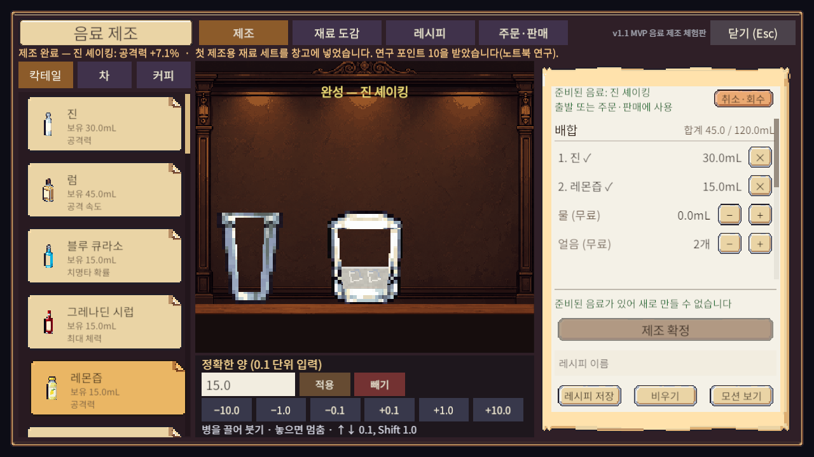
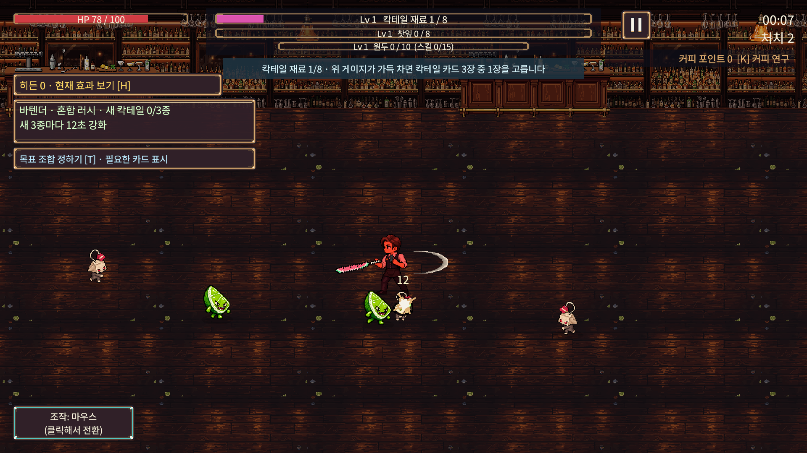
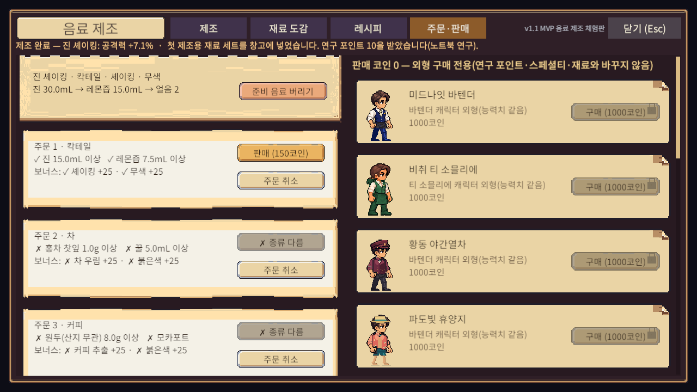

# 음료 마스터 · Beverage Master

**한 잔을 만들고, 나만의 조합으로 살아남으세요.**

칵테일·커피·차를 직접 제조하고, 준비한 음료의 효과와 전투 중 성장 선택을 조합하는 **2D 픽셀 아트 액션 로그라이크**입니다.

**[▶ 무료 Windows 데모 플레이](https://hyungjin-yu.itch.io/coffee-cocktail-tea)** · [플레이 방식](#플레이-방식) · [제작 과정과 검증](Docs/Showcase/verification-2026-11-02.md)

Windows PC 데모 공개 · 싱글플레이 · Unity · 개발 중

*Mix, brew, survive. A pixel-art action roguelike about cocktails, tea, and coffee.*

## 한 잔의 준비가 다음 전투로

바텐더와 티 소믈리에 중 직업을 고르고 전투에 나서세요. 재료를 모으고, 음료를 만들고, 카드와 연구로 다음 성장을 선택합니다. 완성한 음료는 전투에 가져가거나 손님의 주문에 맞춰 판매할 수 있습니다.

| 즐길 거리 | 플레이에서 하는 일 |
|---|---|
| **직접 만드는 음료** | 재료의 양과 제조 기법을 고르고, 완성될 효과를 확인하며 배합을 조정합니다. |
| **세 가지 커피 추출** | 에스프레소 머신·핸드 드립·모카포트 중 추출 도구를 선택합니다. 칵테일 혼합과 차 우리기도 함께 다룹니다. |
| **조합하며 성장하는 전투** | 이동과 위치를 조절하며 자동공격으로 적을 상대하고, 강화 카드·스킬·연구를 조합합니다. |
| **주문과 수집** | 주문 조건에 맞는 음료를 판매하고, 판매 코인으로 캐릭터 외형을 해금합니다. 재료 도감과 레시피도 채워 갑니다. |

## 플레이 방식

1. **준비하기** — 시작 화면에서 직업과 무기를 선택하고, 음료 제조 화면에 들어갑니다. 처음에는 기본 제조 재료가 지급됩니다.
2. **한 잔 만들기** — 재료를 계량하고 제조 기법을 고릅니다. 레시피를 저장하거나 음료를 완성할 수 있습니다.
3. **전투에서 성장하기** — 준비한 음료의 효과를 활용하고, 적을 상대하며 재료와 성장 선택을 모읍니다. 공격은 자동입니다.
4. **다음 선택하기** — 돌아와 새 배합을 시도하거나, 준비한 음료를 주문에 맞춰 판매하고 외형을 수집합니다.

### 픽셀 아트로 표현한 액션

### 제조한 음료를 주문에 맞춰 판매

## 지금 플레이하기

**[itch.io에서 Windows 데모 다운로드](https://hyungjin-yu.itch.io/coffee-cocktail-tea)**

- 최신 공개 파일: `Beverage-Master-Windows-Demo-2026-11-02.zip` — 2026년 11월 3일 업데이트.
- ZIP 전체를 `C:/Games/DrinkMaster`처럼 짧은 경로에 풀고 `CocktailCoffeeTea.exe`를 실행하세요. Unity 에디터나 별도 설치는 필요 없습니다.
- 실행 파일 옆의 데이터 폴더와 DLL을 함께 유지하세요. 매우 긴 경로에서는 실행에 문제가 생길 수 있습니다.
- 개발 중인 데모이며 콘텐츠와 밸런스는 계속 조정하고 있습니다. **Steam 출시도 준비 중입니다.**

| 입력 | 동작 |
|---|---|
| WASD / 방향키 | 이동 |
| 마우스 | 메뉴 선택·음료 제조 |
| 1 / 2 / 3 | 전투 중 카드 선택 |
| K | 커피 연구 확인 |
| H | 해금한 히든 스킬과 효과 확인 |
| Esc | 화면 닫기 / 일시정지 |

공격은 자동입니다. 설정에서 이동 조작 방식을 변경할 수 있습니다.

## 어떻게 만들고 있나요?

기획부터 아트·시스템 구현·검수·데모 공개까지 이어 가는 **개인 게임 제작 프로젝트**입니다. 앱·웹 QA 경험을 바탕으로 요구사항과 재현 조건을 정리하고, AI 도구를 활용해 제작과 개선을 진행하고 있습니다.

| 분야 | 사용 도구와 작업 방식 |
|---|---|
| 엔진·구현 | Unity 6000.3.25f1, C#, URP 2D, Unity Input System |
| 코드·검증 지원 | Codex·Claude를 활용한 기능 구현, 오류 수정, 리팩터링, 테스트 작성과 빌드 검증 |
| 아트 | Aseprite·PixelLab을 활용한 픽셀 아트 제작·수정과 게임 적용 |
| 제작 관리 | 기획·요구사항 정리, AI 작업 지시와 결과 검토, 검수·배포 진행, Git·GitHub 버전 관리 |

AI가 구현한 코드와 생성·보조한 아트가 포함되어 있습니다. 모든 코드를 직접 작성한 프로젝트로 소개하지 않습니다. [리소스 출처와 고지](Delivery/THIRD_PARTY_NOTICES.md)를 함께 확인할 수 있습니다.

### 최근 개선

- 제조·판매·오류 알림이 화면에 표시되지 않던 문제 수정
- 제조 완료 후 준비 음료 안내가 배합 목록과 겹치던 문제 수정
- 판매 버튼에 음료 없음·종류 다름·재료 부족·도구 다름 사유 표시
- 게임을 다시 켰을 때 정상 커피 주문이 취소되던 저장 버그 수정

[11월 2일 빌드의 검증 범위와 남은 과제 →](Docs/Showcase/verification-2026-11-02.md)

## 피드백을 기다립니다

어느 장면이 재미있었는지, 첫 음료를 만들며 어디에서 막혔는지 알려 주세요. 전투의 조합 선택과 제조 과정에서 느낀 점도 환영합니다.

**[itch.io 게임 페이지에 의견 남기기](https://hyungjin-yu.itch.io/coffee-cocktail-tea#comments)**

<strong>개발자를 위한 정보 · 소스 실행 · 저장 · 과거 기록</strong>

### Unity에서 열기

Unity Hub에서 이 저장소를 프로젝트로 추가하고 **Unity 6000.3.25f1**로 엽니다. 패키지 임포트 후 `Assets/_Project/Scenes/Boot.unity`를 열고 실행합니다.

Windows 릴리스 빌드는 Unity 메뉴 `CCT/Build Windows64 Release`에서 생성합니다. 기본 출력은 `Builds/Windows64/`입니다. Unity Test Runner에서 EditMode·PlayMode 검사를 실행할 수 있습니다.

**브랜치별 소스와 공개 데모의 반영 시점은 다를 수 있습니다.** 최신 공개 게임은 위 itch.io 데모를 기준으로 확인해 주세요. Android 빌드·내부 테스트 작업 이력도 있지만, 현재 공개 다운로드는 Windows 데모입니다.

### 주요 폴더

| 폴더 | 내용 |
|---|---|
| `Assets/_Project/Scripts/` | 전투·성장·제조·저장·UI 구현 |
| `Assets/_Project/Resources/` | 게임 데이터와 런타임 리소스 |
| `Assets/_Project/Tests/` | EditMode·PlayMode 테스트 |
| `ArtSource/` | 아트 원본과 제작 자료 |
| `Tools/` | 제작·검증 도구 |
| `Delivery/` | 개발 보고서와 리소스 고지 |
| `Docs/Showcase/` | README용 실제 화면과 검증 요약 |

### 저장 데이터

Windows 기본 저장 폴더: `%USERPROFILE%/AppData/LocalLow/DefaultCompany/CocktailCoffeeTea/`.

진행·음료·설정과 최근 기록을 저장하며 백업 파일도 사용합니다. 런 도중 이어하기는 지원하지 않습니다. 검수할 때는 `-cct-data-dir` 실행 인자로 별도 저장 경로를 지정할 수 있습니다.

실행 ZIP·Unity 캐시·개인 저장 데이터·서명 키는 소스 저장소에 포함하지 않습니다. 별도 오픈소스 라이선스를 선언하지 않았습니다.

[이전 README와 당시 개발 기록](https://github.com/hyungjin-yu/cocktail-coffee-tea-roguelike/blob/68200954a36f3bf5c9b1ec0041dcde40ad13b313/README.md) · [외부 리소스 고지](Delivery/THIRD_PARTY_NOTICES.md)

